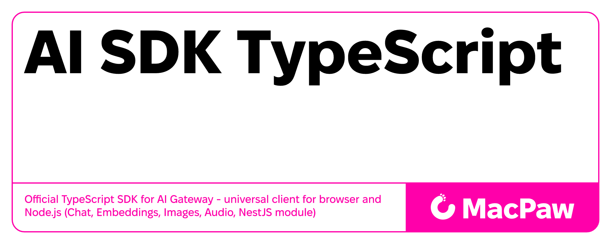

# @macpaw/ai-sdk



[](https://github.com/macpaw/ai-sdk-typescript/actions/workflows/ci.yml)
[](https://www.npmjs.com/package/@macpaw/ai-sdk)
[](./LICENSE)

Thin **Vercel AI SDK** extension for **MacPaw AI Gateway**: OpenAI-compatible providers (`createAIGatewayProvider`, `createGatewayProvider`), a **`createGatewayFetch`** bridge for any HTTP client, **`createVideoClient`** / **`createVoiceClient`** / **`createSpeechClient`** / **`createTranscriptionClient`** for video generation, voice listing, text-to-speech, and speech-to-text, a **`createCreditBalanceClient`** for querying AI credit balances, shared **auth / retry / middleware / errors**, and optional **NestJS** wiring.

Core generation APIs stay on upstream **`ai`** and **`@ai-sdk/*`**. This package only adds Gateway-specific construction and the fetch pipeline.

## Package entry points

| Import                    | Use for                                                                                                                                                                                         |
| ------------------------- | ----------------------------------------------------------------------------------------------------------------------------------------------------------------------------------------------- |
| `@macpaw/ai-sdk`          | **Canonical** — providers, `createGatewayFetch`, `createVideoClient`, `createVoiceClient`, `createSpeechClient`, `createTranscriptionClient`, `createCreditBalanceClient`, errors, config types |
| `@macpaw/ai-sdk/provider` | **Alias** of the root entry (same `dist`; for older snippets)                                                                                                                                   |
| `@macpaw/ai-sdk/nestjs`   | `AIGatewayModule`, `@InjectAIGateway()`, `AIGatewayExceptionFilter`                                                                                                                             |

Upstream **`ai`**, **`@ai-sdk/openai`**, **`@ai-sdk/react`** (or **`ai/react`**) remain the home for Vercel primitives and React hooks.

There is **no** published `@macpaw/ai-sdk/client`, `@macpaw/ai-sdk/runtime`, `@macpaw/ai-sdk/types`, or `@macpaw/ai-sdk/testing` in this version — use `createGatewayFetch` + `fetch` (or the OpenAI SDK with custom `fetch`) for raw HTTP and multipart. See [MIGRATION.md](./MIGRATION.md).

## Install

```bash
pnpm add @macpaw/ai-sdk
# or
npm install @macpaw/ai-sdk
```

Also install upstream packages you call directly, for example `ai`, `@ai-sdk/openai`, `@ai-sdk/react`.

This package does not pin or wrap the upstream UI/hooks API from `ai` / `@ai-sdk/react`. Follow the versioned upstream docs for the exact major version you install there. If your chosen upstream version requires version-specific imports or patterns (for example schema helpers), use the upstream guidance for those APIs.

## Quick start (Vercel AI SDK)

```ts
import { generateText, streamText } from 'ai';
import { createAIGatewayProvider, ErrorCode } from '@macpaw/ai-sdk';

const gateway = createAIGatewayProvider({
  env: 'production',
  getAuthToken: async () => (await getSetappSession()).accessToken,
});

const { text } = await generateText({
  model: gateway('openai/gpt-4.1-nano'),
  prompt: 'Hello from AI Gateway',
});

const result = streamText({
  model: gateway('openai/gpt-4.1-nano'),
  prompt: 'Write a poem',
});
for await (const delta of result.textStream) {
  process.stdout.write(delta);
}
```

## Features

- **Vercel-first** — `OpenAIProvider` from `@ai-sdk/openai` + custom `fetch`
- **Auth** — `getAuthToken(forceRefresh?)`; one automatic retry on **401** with `forceRefresh === true`
- **Retry** — exponential backoff for **429** and **5xx** (and some network errors); not for 401/402
- **Middleware** — `(config, next) => Promise<Response>` chain before `fetch`
- **Errors** — Gateway JSON and OpenAI-shaped bodies → `AIGatewayError` subclasses + `ErrorCode`
- **Request ID** — `X-Request-ID` on Gateway requests when missing
- **Timeout** — per attempt, combined with caller `AbortSignal`
- **Video generation** — `createVideoClient` wraps the Gateway video endpoints (create job, poll status, fetch content)
- **Voices** — `createVoiceClient` lists voices from Gateway providers (paginated `GET /v1/voices`)
- **Speech (text-to-speech)** — `createSpeechClient` generates streaming speech audio (`POST /v1/audio/speech`)
- **Transcription (speech-to-text)** — `createTranscriptionClient` transcribes audio with OpenAI or ElevenLabs models (`POST /v2/audio/transcriptions`)
- **Credit balances** — `createCreditBalanceClient` fetches active AI credit balances for the authenticated user
- **Tree-shakeable** — ESM + CJS

## Configuration (`GatewayProviderSettings`)

Used by `createAIGatewayProvider`, `createGatewayProvider`, `createGatewayFetch`, `createVideoClient`, `createVoiceClient`, `createSpeechClient`, `createTranscriptionClient`, `createCreditBalanceClient`, and Nest `AIGatewayModule`.

| Field          | Purpose                                                          |
| -------------- | ---------------------------------------------------------------- |
| `getAuthToken` | Required — `Promise<string \| null>`; `true` = refresh after 401 |
| `env`          | `'production'` → default base URL `https://api.macpaw.com/ai`    |
| `baseURL`      | Override gateway root (staging, etc.)                            |
| `headers`      | Extra headers (do not set `Authorization` here)                  |
| `retry`        | `RetryConfig` or `false`                                         |
| `timeout`      | ms per attempt (default `60000`)                                 |
| `middleware`   | Interceptor stack                                                |
| `fetch`        | Custom `fetch` implementation                                    |

Internal resolution: `resolveConfig()` in `gateway-config.ts`.

## `createGatewayFetch` — raw HTTP / multipart

Same auth, retry, middleware, and error normalization as the provider path. The base already includes `/ai`, so use **relative** URLs under it (e.g. `'/v1/images/edits'`, which resolves to `https://api.macpaw.com/ai/v1/images/edits`) or absolute URLs that stay under the same gateway origin.

```ts
import { createGatewayFetch, resolveGatewayBaseURL } from '@macpaw/ai-sdk';

const baseURL = resolveGatewayBaseURL(undefined, 'production', 'gatewayFetch');
const gatewayFetch = createGatewayFetch({
  baseURL,
  getAuthToken: async () => token,
});

const form = new FormData();
form.append('image', imageBlob, 'photo.png');
form.append('prompt', 'Add a hat');
form.append('model', 'openai/dall-e-2');

const res = await gatewayFetch('/v1/images/edits', { method: 'POST', body: form });
```

Non-gateway absolute URLs are passed through without injecting Bearer auth (placeholder key is stripped). See `gateway-fetch.ts`.

`createGatewayFetch` requires a resolved `baseURL`. Use the exported `resolveGatewayBaseURL()` helper if you want the same `'production'` shortcut that provider factories support.

## `createGatewayProvider` — prefixed model IDs

Bare model IDs get a default Gateway prefix per provider constant; IDs that already contain `/` are unchanged.

| Constant                              | Default prefix                        |
| ------------------------------------- | ------------------------------------- |
| `GATEWAY_PROVIDERS.ANTHROPIC`         | `anthropic`                           |
| `GATEWAY_PROVIDERS.GOOGLE`            | `google`                              |
| `GATEWAY_PROVIDERS.XAI`               | `xai`                                 |
| `GATEWAY_PROVIDERS.GROQ`              | `groq`                                |
| `GATEWAY_PROVIDERS.MISTRAL`           | `mistral`                             |
| `GATEWAY_PROVIDERS.AMAZON_BEDROCK`    | `bedrock`                             |
| `GATEWAY_PROVIDERS.AZURE`             | `azure`                               |
| `GATEWAY_PROVIDERS.COHERE`            | `cohere`                              |
| `GATEWAY_PROVIDERS.PERPLEXITY`        | `perplexity`                          |
| `GATEWAY_PROVIDERS.DEEPSEEK`          | `deepseek`                            |
| `GATEWAY_PROVIDERS.TOGETHERAI`        | `togetherai`                          |
| `GATEWAY_PROVIDERS.OPENAI_COMPATIBLE` | **requires** `modelPrefix` in options |

```ts
import { generateText } from 'ai';
import { createGatewayProvider, GATEWAY_PROVIDERS } from '@macpaw/ai-sdk';

const anthropic = createGatewayProvider(GATEWAY_PROVIDERS.ANTHROPIC, {
  env: 'production',
  getAuthToken: async () => token,
});

await generateText({
  model: anthropic('claude-sonnet-4-20250514'),
  prompt: 'Hello',
});
```

## Provider options (`AIGatewayProviderOptions`)

Extends `GatewayProviderSettings` plus OpenAI provider settings (without `apiKey` / `baseURL` / `fetch`, which are wired by the SDK):

- `normalizeErrors` — default `true`; non-OK Gateway responses throw typed errors
- `createOpenAI` — optional override of `createOpenAI` from `@ai-sdk/openai` (tests/advanced)

Use `normalizeErrors: false` only when you intentionally want to inspect raw failed `Response` objects in provider-driven tests or adapters. Auth refresh and retry behavior still stay on; only typed non-OK error throwing is relaxed.

## `createVideoClient` — video generation

Wraps three Gateway endpoints: create a job, poll its status, and fetch binary content. Same auth and error normalization as the other clients.

```ts
import { createVideoClient } from '@macpaw/ai-sdk';

const videos = createVideoClient({
  env: 'production',
  getAuthToken: async () => (await getSetappSession()).accessToken,
});

const job = await videos.create({
  model: 'veo-2',
  prompt: 'A sunset over the ocean',
  seconds: '5',
  size: '1280x720',
});

let current = job;
while (current.status !== 'completed' && current.status !== 'failed') {
  await new Promise((r) => setTimeout(r, 3000));
  current = await videos.get(job.id);
}

const res = await videos.getContent(job.id, 'video');
const buffer = await res.arrayBuffer();
```

`getContent` returns the raw `Response` so callers can consume `.arrayBuffer()`, `.blob()`, or `.body` as a stream — the `Content-Type` is provider-dependent (`video/mp4`, `image/jpeg`, etc.). Pass `'thumbnail'` or `'spritesheet'` as the second argument to fetch those variants instead.

`create` does **not** retry on 5xx — POST video jobs are non-idempotent. Auth retry (401 → fresh token) still applies.

## `createVoiceClient` — list voices

Wraps `GET /v1/voices`. Same auth, retry, and error normalization as the other clients. `provider` is required; `"elevenlabs"` is the only Gateway provider today, but any future provider id can be passed as a string.

```ts
import { createVoiceClient } from '@macpaw/ai-sdk';

const voices = createVoiceClient({
  env: 'production',
  getAuthToken: async () => (await getSetappSession()).accessToken,
});

const first = await voices.list({ provider: 'elevenlabs' });
for (const voice of first.voices) {
  console.log(voice.voice_id);
}

if (first.has_more) {
  const next = await voices.list({
    provider: 'elevenlabs',
    next_page_token: first.next_page_token,
  });
  console.log(next.voices.length);
}
```

Each `Voice` always has `voice_id`; other fields are provider-specific and passed through as-is. `list()` is a GET, so config-level retries on **429** / **5xx** still apply. Auth retry (401 → fresh token) also applies.

## `createSpeechClient` — text-to-speech

Wraps `POST /v1/audio/speech`. **Streaming only** — the response is always Server-Sent Events (or the provider's own raw stream when `raw_provider_response: true`), never a single buffered file, so `create()` returns the raw `Response` for callers to consume as a stream. `model` (`provider/model`), `input`, and `voice` are required; every other parameter is validated per model by the Gateway, so `response_format` and any additional model-specific fields are passed straight through.

```ts
import { createSpeechClient } from '@macpaw/ai-sdk';

const speech = createSpeechClient({
  env: 'production',
  getAuthToken: async () => (await getSetappSession()).accessToken,
});

const response = await speech.create({
  model: 'openai/gpt-4o-mini-tts',
  input: 'Today is a wonderful day to build something people love!',
  voice: 'alloy',
  response_format: 'mp3',
});

// response.body is a ReadableStream of `text/event-stream` bytes by default —
// parse it as SSE to read `speech.audio.delta` / `speech.audio.done` events.
```

`create()` disables config-level retries (POST is non-idempotent — retrying on 5xx risks duplicate provider-side generation and credit charges). Auth retry (401 → fresh token) still applies. Set `raw_provider_response: true` to receive the selected provider's own stream unmodified (for ElevenLabs, its native JSON stream including alignment data the normalized events cannot carry).

## `createTranscriptionClient` — speech-to-text

Wraps `POST /v2/audio/transcriptions` (multipart). The SDK types only the Gateway's own contract: `model` (`provider/model`), exactly one of `file` (a `Blob` / `File`, `ArrayBuffer`, typed array or Node `Buffer`) or `source_url` (enforced by the request type, and at runtime with a `TypeError` for untyped callers), `language`, and `stream`. Everything else is provider-specific — which fields apply and which response shape comes back are decided by the model's provider (today `openai` and `elevenlabs`) and validated by the Gateway — so those fields are forwarded **as sent, under their native names**, and the provider's response is returned unchanged. A new provider or parameter needs no SDK update.

```ts
import { createTranscriptionClient } from '@macpaw/ai-sdk';

const transcriptions = createTranscriptionClient({
  env: 'production',
  getAuthToken: async () => (await getSetappSession()).accessToken,
});

// JSON response — name the shape you expect with the type argument
const result = await transcriptions.create<{ text: string }>({
  model: 'openai/gpt-4o-transcribe',
  file: new File([audioBytes], 'meeting.mp3', { type: 'audio/mpeg' }),
  language: 'en',
});

// Provider-specific fields use the provider's own names (see its native API docs)
const transcript = await transcriptions.create({
  model: 'elevenlabs/scribe_v2',
  source_url: 'https://cdn.example.com/audio/meeting.mp3',
  diarize: true,
  keyterms: ['MacPaw', 'CleanMyMac'],
});

const verbose = await transcriptions.create({
  model: 'openai/whisper-1',
  file,
  response_format: 'verbose_json',
  'timestamp_granularities[]': ['word', 'segment'],
});

// text/plain responses (e.g. OpenAI srt / vtt / text) come back as a string
const srt = await transcriptions.create<string>({ model: 'openai/whisper-1', file, response_format: 'srt' });

// stream: true — raw Response with a `text/event-stream` body
const stream = await transcriptions.create({ model: 'openai/gpt-4o-mini-transcribe', file, stream: true });
```

- Return value: parsed JSON (the provider's response), the body as a `string` for `text/plain`, or the raw `Response` for a `text/event-stream` response. `TranscriptionResponse` is any JSON value, since the SDK does not assume a provider's shape. Typed as `Response` for `stream: true`, `TranscriptionResponse | string` by default (narrow it, or pass `T` such as `create<string>()` / `create<{ text: string }>()`), and `TranscriptionResponse | string | Response` when `stream` is a runtime `boolean`.
- Form encoding: arrays become repeated parts under the exact key you give (use `'include[]'`, `'timestamp_granularities[]'` etc. where the provider expects the suffix), `Blob` / `File` and binary values (`ArrayBuffer`, typed arrays, `Buffer`) are sent as file parts, `Date` as an ISO string, other objects are JSON-encoded, other values stringified, `undefined` / `null` skipped.
- For a plain `Blob` or raw bytes, pass `filename` (e.g. `'clip.m4a'`) — providers may detect the format from the extension. Any other `file` value is rejected with a `TypeError` before the request is sent.
- A `Content-Type` set in the client's `headers` is ignored for this request so `fetch` can set the multipart boundary.
- `create()` disables config-level retries (non-idempotent, billed). Auth retry (401 → fresh token) still applies.
- Timeout defaults to `DEFAULT_TRANSCRIPTION_TIMEOUT_MS` (10 minutes, not the SDK-wide 60 s) because uploads can reach 512 MB; set `timeout` on the client to change it. Pass `{ signal }` as the second argument to cancel a call: `transcriptions.create(request, { signal: controller.signal })`.
- Unsupported combinations (e.g. `stream` or `source_url` on a provider that lacks them) are rejected by the Gateway with **400** → `AIGatewayError` with `metadata.errors`.

> **Deprecated:** `POST /v1/audio/transcriptions` — reached through the provider's `transcription()` model (e.g. `experimental_transcribe({ model: gateway.transcription('openai/whisper-1') })`) or `createGatewayFetch('/v1/audio/transcriptions')` — is deprecated. Use `createTranscriptionClient` instead.

## `createCreditBalanceClient` — AI credit balances

Fetches all active AI credit balances for the user identified by the Bearer token. Balances are ordered FEFO (First Expiring, First Out) and include optional membership metadata.

```ts
import { createCreditBalanceClient } from '@macpaw/ai-sdk';

const balance = createCreditBalanceClient({
  env: 'production',
  getAuthToken: async () => (await getSetappSession()).accessToken,
});

const { data } = await balance.getBalances();

console.log(data.totalAvailable.amount); // e.g. "1000000"
console.log(data.totalAvailable.currency); // "MACPAW_CREDITS"

for (const b of data.balances) {
  console.log(b.id, b.currentValue.amount, b.expiresAt);
}
```

`getBalances` calls `GET /entitlement/v1/ai/credits/balances` on the gateway's root domain (derived from your `baseURL` origin). The response shape mirrors the API spec exactly — `data.balances`, `data.totalAvailable`, and `data.totalInitialAmount`.

## Middleware

```ts
import type { Middleware } from '@macpaw/ai-sdk';

const loggingMiddleware: Middleware = async (config, next) => {
  const response = await next(config);
  console.log(config.method, config.url, response.status);
  return response;
};
```

## Error handling

| `ErrorCode`                                   | Typical HTTP | Meaning                                |
| --------------------------------------------- | ------------ | -------------------------------------- |
| `AuthRequired`                                | 401          | Token missing / expired                |
| `InsufficientCredits` / `SubscriptionExpired` | 402          | Billing / subscription                 |
| `ModelNotAllowed`                             | 403          | Model denied                           |
| `RateLimited`                                 | 429          | Rate limit (`retryAfter` when present) |
| `Validation`                                  | 422          | Validation body                        |
| …                                             | …            | See `gateway-errors.ts`                |

```ts
import { AIGatewayError, ErrorCode, isAIGatewayError } from '@macpaw/ai-sdk';

try {
  // ...
} catch (e) {
  if (isAIGatewayError(e) && e.code === ErrorCode.InsufficientCredits) {
    // e.metadata.paymentUrl, e.requestId, etc.
  }
}
```

## NestJS

```bash
pnpm add @macpaw/ai-sdk @nestjs/common rxjs
```

Register once (global by default):

```ts
import { AIGatewayModule } from '@macpaw/ai-sdk/nestjs';

AIGatewayModule.forRoot({
  env: 'production',
  getAuthToken: async () => process.env.SETAPP_TOKEN!,
});
```

If your Nest app uses TypeScript subpath exports strictly, make sure its `tsconfig` uses a modern resolver such as `moduleResolution: "Node16"`, `"NodeNext"`, or `"bundler"` so `@macpaw/ai-sdk/nestjs` resolves correctly.

Inject **`GatewayProviderSettings`** (not an HTTP client) and build providers in the service:

```ts
import { Injectable } from '@nestjs/common';
import { InjectAIGateway } from '@macpaw/ai-sdk/nestjs';
import type { GatewayProviderSettings } from '@macpaw/ai-sdk';
import { createAIGatewayProvider } from '@macpaw/ai-sdk';
import { generateText } from 'ai';

@Injectable()
export class ChatService {
  constructor(@InjectAIGateway() private readonly config: GatewayProviderSettings) {}

  async complete(prompt: string) {
    const gateway = createAIGatewayProvider(this.config);
    const { text } = await generateText({
      model: gateway('openai/gpt-4.1-nano'),
      prompt,
    });
    return text;
  }
}
```

`AIGatewayExceptionFilter` maps `AIGatewayError` to JSON HTTP responses. See `examples/nestjs/` for a copy-paste skeleton.

Only documented root exports are public API. Source-level helpers such as `parseErrorResponseFromResponse` and `parseStreamErrorPayload` may exist internally, but they are not supported import targets unless exported from `@macpaw/ai-sdk`.

## Examples

From the repo root:

```bash
pnpm build
pnpm example:provider
```

Set `AI_GATEWAY_TOKEN` or `SETAPP_TOKEN`. Optional: `AI_GATEWAY_BASE_URL`, `AI_GATEWAY_MODEL`.

See [`examples/README.md`](./examples/README.md).

## Release & quality

- CI: `typecheck`, `lint`, `test`, coverage, `build` on Node 18 / 20 / 22
- `pnpm verify:release` — full local gate before publish
- `pnpm size:pack` — dry-run npm pack

## AI assistant setup

Templates for **Cursor** (`.cursor/skills/`), **Claude Code** (`CLAUDE.md`), and **OpenAI Codex** (`AGENTS.md`) ship under `templates/`. After installing the package:

```bash
pnpm exec macpaw-ai-setup
# or: npx macpaw-ai-setup
```

Use `macpaw-ai-setup cursor`, `claude`, or `codex` to install only one target. Existing root `CLAUDE.md` / `AGENTS.md` files get Gateway sections appended, not replaced.

The installed instructions enforce the current package surface and the main auth guardrails:

- prefer `@macpaw/ai-sdk` / `@macpaw/ai-sdk/nestjs`
- keep generation primitives on upstream `ai` / `@ai-sdk/*`
- do not use removed subpaths such as `client`, `runtime`, `types`, or `testing`
- do not invent a token source or expose gateway tokens to browser-only code
- use `baseURL` for staging/custom hosts; `env` supports only `'production'`

## Versioning

[Semantic Versioning](https://semver.org/). Releases via [semantic-release](https://github.com/semantic-release/semantic-release) and Conventional Commits.

## License

MIT © 2026 [MacPaw Way Ltd](https://macpaw.com). See [LICENSE](LICENSE).
